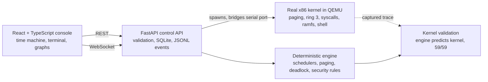

# ROHIT OS

**An operating-system laboratory that explains its own decisions, and a real bootable kernel you can drive from your browser.**

  

## Why this is different
Most student OS projects draw an algorithm's output. This one **proves its claims**:

| Claim | How it is checked |
|---|---|
| The simulator models a real scheduler | It predicts the real kernel's dispatch order; **59/59** switches match a trace captured from QEMU |
| Scheduling code is correct | Hand-calculated metrics, invariants, **500-workload fuzzing**, deterministic replay hashes |
| The tests are not decorative | **Mutation check:** 12 deliberately injected bugs, all caught (`docs/MUTATION.md`) |
| The kernel really enforces protection | Ring-3 programs are stopped by the CPU's privilege and paging checks; a test drives this **through the browser** |
| Benchmarks are honest | Seeded workloads, raw CSV, trade-offs shown (no policy wins everywhere) |

## Architecture

The simulator models OS mechanisms and does not control the host. The kernel is a separate program that runs only in an emulator.

## Try it in 60 seconds
`make demo` builds the UI and serves it at http://127.0.0.1:8000. Then:
1. **kernel.log** tab, press *boot real kernel*, click `run`, then `crash`. The CPU kills the misbehaving user program and the kernel survives.
2. **evidence** tab, click *validate against kernel*: the simulator's prediction lines up with the real kernel.
3. **scheduler** tab, *execute run*, *play*: step through every decision with its explanation.

Engineering notes and limits: `docs/REPORT.md`, `docs/MUTATION.md`, `docs/VIVA.md`, `docs/PITCH.md`.

---

## Details

Two tracks that are deliberately separate. The simulator models OS mechanisms; the kernel runs on
(emulated) hardware. Neither controls the host computer's operating system.

## Track A: OS laboratory (Python engine + FastAPI + React/TypeScript)
- `os-engine/rohitos/core.py` FCFS, SJF, Priority, Round Robin on a logical clock; event log; metrics; event-stream hash.
- `memory.py` FIFO, LRU, Optimal (offline baseline). `deadlock.py` detection, Banker's avoidance, victim-kill recovery.
- `security.py` rule-based audit (spawn bursts, file attempts, CPU limit, forbidden paths). Simulated responses only.
- `backend/app.py` the API contract from the blueprint (runs, start/pause/step/reset, state, events, metrics, compare),
  plus memory, deadlock and security endpoints. SQLite stores run metadata; events are saved as JSONL.
- `frontend/` hacker-console UI: boot sequence, live terminal wired to the API, scrubbable Time Machine replay with CPU and ready-queue view, counterfactual bar charts, animated paging, resource-allocation graph with recovery, security alert feed, captured kernel log. It only calls the API; no algorithm logic lives in React.
- `lab.html` standalone single-file version of the scheduler/paging lab (no server needed).

    make deps      # pip install -U -r requirements.txt (FastAPI and Starlette must be upgraded together)
    make test      # engine tests + kernel boot test
    make serve     # builds UI, serves UI and API at http://127.0.0.1:8000

Conventions: step unit = one event; SJF and Priority are non-preemptive; lower priority number runs first;
ties break by arrival then pid; context switches count dispatches that change the running process.

## Evidence tools (what makes the claims checkable)
- **Kernel validation:** the engine predicts the real kernel's round-robin dispatch order; the captured QEMU trace matches 59 of 59 switches
  (`tools/capture_kernel.py` regenerates the trace from a fresh boot; `workloads/kernel_trace.json` is that capture).
- **Benchmark matrix:** 3 workload families x 4 policies, seeded, with CSV export (`/api/benchmark`).
- **Fuzz lab:** random workloads checked for conserved bursts, no run-before-arrival, non-negative waiting, identical replay hash.
- **Policy advisor:** recommends a policy for a stated goal and prints the evidence, including convoy-effect detection. It advises; it does not switch policies automatically.

## Documents
`docs/REPORT.md` (generated from real results by `make report`), `docs/VIVA.md` (viva preparation), `docs/benchmark.csv`, charts in `docs/`.

## Track B: bootable kernel (`kernel/`, 32-bit x86, QEMU)
GDT with ring 3 + TSS, IDT with 32 exception handlers, PIC/PIT timer, paging with demand mapping,
page allocator, preemptive round-robin tasks, ring-3 user programs, `int 0x80` syscalls (write, exit, ticks,
read file) with user-pointer validation, RAM filesystem, keyboard IRQ + serial shell.

    cd kernel && make test         # boots in QEMU, 12 checks, exit 0 on PASS
    cd kernel && make shell-test   # scripted shell session
    cd kernel && make run          # interactive: type help

Requires gcc with -m32 support, binutils, make, qemu-system-i386.

## Verified in this build
- 14 engine/API tests pass, including hand-calculated metrics for the Appendix A workload, scheduler invariants,
  known page-fault counts (FIFO 15 / LRU 12 / Optimal 9, Belady's anomaly), deadlock and Banker cases, replay determinism.
- Kernel boots in QEMU and passes its self-test; shell session verified. Frontend type-checks and builds; the built UI and
  API were served together and queried over HTTP. The UI was not driven by a browser in this build.

## Known limits
Kernel: 32-bit only, 32 MB identity map, one user program at a time, no per-process address spaces, file data capped at
255 bytes, no disk. The "adaptive scheduler" is a measured comparison, not an automatic policy switch. The 10-week
benchmark report and screenshots are still to be produced by running the suite on your own machine.
