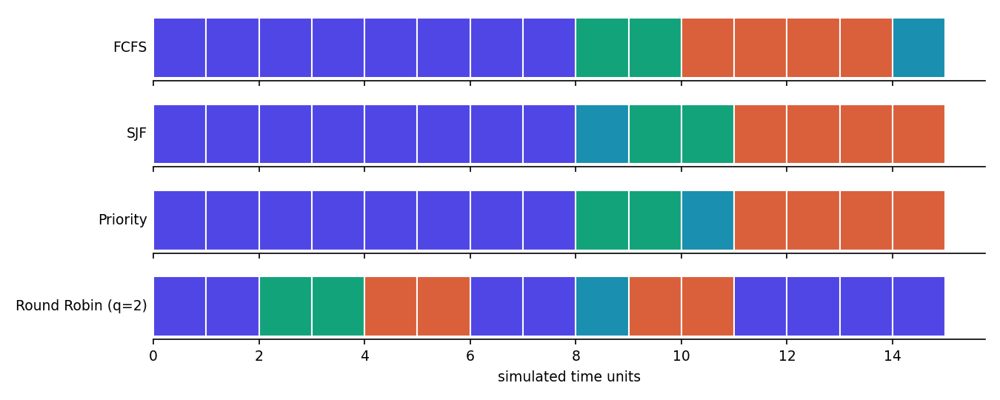
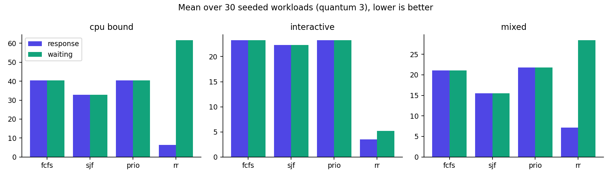

# ROHIT OS: An Explainable Operating-System Laboratory with Deterministic Event Replay and a Bootable Kernel Prototype

## 1. Abstract
ROHIT OS has two deliberately separate tracks. **Track A** is a deterministic OS laboratory (CPU scheduling, page replacement, deadlock handling,
rule-based security auditing) exposed through a FastAPI service and a React/TypeScript console. Every run is an ordered event log with a replay hash,
so any scheduling decision can be inspected and re-run under another policy. **Track B** is a bootable 32-bit x86 kernel that runs in QEMU with
paging, ring-3 user programs, system calls and a RAM filesystem. The tracks are connected by an experiment: the simulator predicts the kernel's
scheduling order and is checked against a trace captured from a real boot (59 of 59 dispatches matched).

## 2. Scope and boundaries
The simulator models OS mechanisms in a controlled environment; it does not control the host operating system. The kernel is a separate program
that runs only inside an emulator. Security features are rule-based demonstrations over synthetic events, not malware detection.

## 3. Architecture
Engine (`os-engine/rohitos`) owns all algorithms on a logical clock. The API (`backend/app.py`) validates input, stores run metadata in SQLite and
event streams as JSONL. The UI (`frontend/`) is a client of the API and contains no algorithm logic. The kernel (`kernel/`) is built with a
cross-compiler and tested by booting it in QEMU.

## 4. Metric definitions
Turnaround = completion - arrival. Waiting = turnaround - burst. Response = first CPU start - arrival. Throughput = jobs / simulated time.
Context switches count dispatches that change the running process. Fairness is reported as the longest single wait. Ties break by arrival, then name.
SJF and Priority are non-preemptive; a lower priority number runs first.

## 5. Results
### 5.1 Appendix A workload (hand-calculated, then verified by tests)
| Policy | Avg waiting | Avg turnaround | Avg response | Context switches | Event-stream hash |
|---|---|---|---|---|---|
| FCFS | 6.50 | 10.25 | 6.50 | 4 | 57fea918489a6424 |
| SJF | 5.50 | 9.25 | 5.50 | 4 | 5ab1f01a4957f112 |
| Priority | 5.75 | 9.50 | 5.75 | 4 | 24ef9ec87e0ea742 |
| Round Robin (q=2) | 4.50 | 8.25 | 2.00 | 7 | a58e99b53ebe0e50 |

Round Robin gives the best response time (2.00 vs 6.50 for FCFS) and waiting time on this workload but needs the most context switches.

### 5.2 Benchmark matrix (30 seeded workloads per family, quantum 3)
| Family | Policy | Wait | Turnaround | Response | Max wait | Switches |
|---|---|---|---|---|---|---|
| cpu_bound | fcfs | 40.411 | 57.806 | 40.411 | 81.467 | 6 |
| cpu_bound | sjf | 32.806 | 50.2 | 32.806 | 75.4 | 6 |
| cpu_bound | prio | 40.411 | 57.806 | 40.411 | 81.467 | 6 |
| cpu_bound | rr | 61.589 | 78.983 | 6.289 | 75.767 | 35.733 |
| interactive | fcfs | 23.243 | 29.233 | 23.243 | 29.3 | 7 |
| interactive | sjf | 22.343 | 28.333 | 22.343 | 31.367 | 7 |
| interactive | prio | 23.243 | 29.233 | 23.243 | 29.3 | 7 |
| interactive | rr | 5.176 | 11.167 | 3.471 | 11.933 | 9.967 |
| mixed | fcfs | 21.092 | 28.538 | 21.092 | 42.933 | 8 |
| mixed | sjf | 15.471 | 22.917 | 15.471 | 40.933 | 8 |
| mixed | prio | 21.75 | 29.196 | 21.75 | 45.8 | 8 |
| mixed | rr | 28.4 | 35.846 | 7.167 | 41.833 | 22.567 |

Raw data: `benchmark.csv`. For the three non-preemptive policies response equals waiting by definition, so their bars match. No policy wins every measure: the trade-offs between response time, waiting time and switch count depend on the workload family.

### 5.3 Correctness evidence
- Fuzzing: 500 random workloads x 4 policies = 2000 runs, 29972 invariant checks, **0 violations**.
- Page replacement on the classic reference string with 3 frames: FIFO 15, LRU 12, Optimal 9 faults (matches the textbook values). Belady's anomaly is reproduced in tests.
- Deadlock: the classic two-process cycle is detected (deadlocked processes [0, 1]); recovery by victim termination clears it. Banker's safety is tested on the textbook state.
- Security audit: 3 alerts raised on the synthetic attack scenario (cpu_limit, forbidden, spawn_burst); benign file access raised none.
- Replay: identical workload and policy produce an identical event-stream hash.

### 5.4 Simulator validated against the real kernel
The engine models the kernel's round-robin scheduler (quantum 5, four tasks) and predicts its dispatch order. The kernel's actual trace was captured from a QEMU boot
(`qemu-system-i386 autotest boot`). Result: **59/59** dispatches identical. A test confirms the comparison fails when the trace is altered.

### 5.5 Kernel self-test (captured serial output)
The kernel passes 12 boot-time checks: GDT with ring-3 segments and TSS; page allocator reuse; paging enabled; IDT with exception, timer, keyboard and syscall gates;
breakpoint handled and resumed; demand paging; a ring-3 program using write/read-file/exit syscalls; a user `cli` stopped by the privilege check; a user read of kernel
memory stopped by paging; RAM filesystem; preemptive round-robin across three tasks.

### 5.6 Policy advisor
For the Appendix A workload with a response-time goal the advisor recommends **rr**. Evidence it prints: 4 processes; burst spread (std/mean) 0.71; 2 short job(s) arrive while the longest (P1, burst 8) can be running. Under FCFS, P4 (burst 1) waits 11 units, 11.0x its own burst: a convoy effect. rr improves avg_response from 6.50 (fcfs) to 2.00, a 69% gain, with 7 context switches versus 4.

## 6. Limitations and honest notes
The kernel is 32-bit with one address space, one user program at a time, 255-byte files and no disk. The scheduler comparison is advice, not an automatic policy switch.
Benchmarks use synthetic seeded workloads, not real traces. The validation checks scheduling order, not timing in real time. The web UI was checked by build and API tests, not by automated browser tests.

## 7. Future work
64-bit long mode, per-process address spaces, preemptive user tasks, a block device and filesystem, automatic policy switching evaluated against a held-out workload set, and browser end-to-end tests.

## 8. Reproduce
`make deps && make test` runs the engine tests and boots the kernel; `python3 tools/capture_kernel.py` regenerates the kernel trace; `python3 tools/build_report.py` regenerates this report and its charts.
